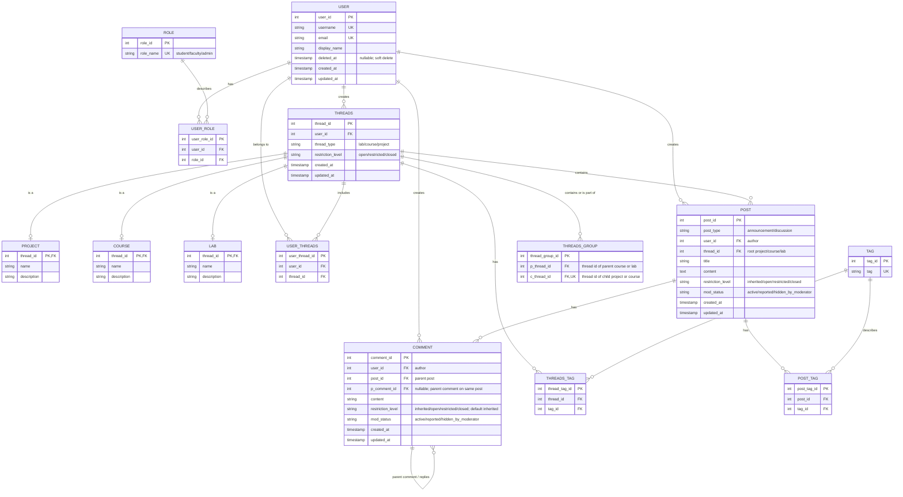

### ERD constraints and lifecycle notes

- All `created_at` and `updated_at` columns are non-null. `created_at` defaults to the current timestamp; `updated_at` defaults to it and is refreshed whenever the row is updated.
- Use a database update trigger (or equivalent centralized persistence mechanism) to refresh `updated_at` consistently on updates.
- String-backed constrained values use database `CHECK` constraints rather than native database enums:
  - `ROLE.role_name`: `student`, `faculty`, `admin`
  - `THREADS.thread_type`: `lab`, `course`, `project`
  - `THREADS.restriction_level`: `open`, `restricted`, `closed`
  - `POST.post_type`: `announcement`, `discussion`
  - `POST.restriction_level` and `COMMENT.restriction_level`: `inherited`, `open`, `restricted`, `closed`
  - `POST.mod_status` and `COMMENT.mod_status`: `active`, `reported`, `hidden_by_moderator`
- `POST.mod_status` and `COMMENT.mod_status` default to `active`; `POST.restriction_level` and `COMMENT.restriction_level` default to `inherited`.
- Each `THREADS` row must have exactly one matching subtype row in `PROJECT`, `COURSE`, or `LAB`, matching `thread_type`. Enforce this with deferred database constraint triggers so a base row and its subtype can be inserted or changed in one transaction.
- A `THREADS_GROUP.c_thread_id` may occur only once, enforcing at most one parent per child. A database trigger enforces valid parent-child types (Lab-to-Course and Course-to-Project); self-parenting is prohibited.
- `COMMENT.p_comment_id` is nullable. When populated, the parent comment must belong to the same `post_id`; enforce this with a composite foreign key from `(p_comment_id, post_id)` to `(comment_id, post_id)` on `COMMENT`, with a corresponding unique constraint on `(comment_id, post_id)`.
- User deletion is soft deletion: set `USER.deleted_at`, and set the restriction level to `closed` for that user's created threads, posts, and comments. Do not cascade-delete those rows when a user is soft-deleted.
- Direct deletion of a thread or post cascades to dependent rows, including subtype, hierarchy, association/tag, post, and comment rows as applicable. Deleting a parent thread also deletes its child threads recursively; use a database trigger or an equivalent transactional deletion operation for this hierarchy behavior.
- User-role assignment must ensure each user has at least one role; when no role is supplied, assign the `student` role.