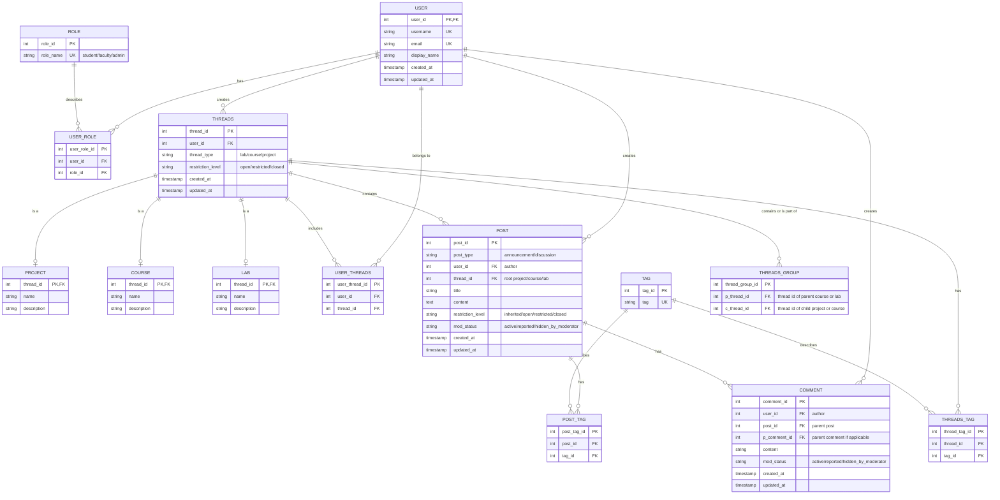

#### AI Contribution Weight: [40%] AI Generated / [60%] Human Written


# Design Specifications
Project Portal Research Blog & Project Discussion Board Service
Version 2.0

#### Notes
##### Version 1 
I used Copilot to help generate initial ideas and a baseline to start from, but this document is originally largely written by hand. The first draft did not include the constraints section or mock data and only included create operations for JSON schemas, so those portions and the remainder of the JSON schemas were generated using that first draft and then edited. The AI contribution percentage above is a rough estimate representing the contribution of the initial generated baseline plus those added sections, not the actual text percentage in this document.

The log of the conversation is lengthy, so I have included it as a separate AI log file in this repo.

##### Version 2
ERD restructured manually to match new project specifications for release 2. Updated API endpoints, field details and constraints, and JSON schemas created with AI assistance and adjusted manually as needed. 

AI description included in conceptual_journal.md, full AI log included in AI_external_log.md.

---
## Overview
The Research Blog & Project Discussion Board (RBPDB) Service is a backend service within the Project Portal ecosystem. It is responsible for managing the API that will update and retrieve data from the RBPDB and the database that will store that data.

### Tech Stack
- Python
- FastAPI
- PostgreSQL
- Docker

### Basic Structure Description
**USER**
Users are students, faculty members, or admins for the RBPDB. They have usernames and other identifying information, and they can create or modify Threads and Posts on the board. They are assigned one or more of three roles (Student, Faculty, and Admin) depending on their position within the university, affecting whether they are able to create certain types of Posts or moderate Threads.

**THREAD**
Threads are the basis of the board. They can be one of three types within a hierarchical structure:  a Project Thread representing an individual student project, a Course Thread encompassing multiple Project Threads, or a Lab Thread encompassing multiple Course Threads. Posts can be bound directly to any of these three types of Threads. They have titles and descriptions, as well as optional categorizing tags. Threads can also be tied to one or more Users to denote them as authors of a Project or attendees of a Course or Lab, which can affect and restrict the Threads and Posts they are able to create and comment on. Threads have three restriction levels as well: Open Threads allow Posts and Comments from any User, Restricted Threads allow Posts and Comments from any User tied to the Thread (or any Faculty or Admin User), and Closed Threads can only be modified by an Admin User.

**POST**
Posts are either discussions or announcements within a Thread. They are authored by Users and have a title and content as well as optional categorizing tags. Announcement Posts are restricted to Users with the Faculty role, but Discussion posts can be made by any User depending on the restriction level of the Thread they are bound to. Posts have their own restriction levels dictating which Users can comment. This is inherited from its Thread's restriction level by default but can be changed for individual Posts if the author is a Faculty or Admin user. Posts can also be reported by any User and hidden by any Faculty or Admin User after being reported.

**COMMENT**
Comments are used to reply to a Post or another Comment. They are similar to Posts, with a few key differences: they contain a simple message string without titles or tags or an announcement/discussion distinction, they must have a parent Post or Comment they are replying to, and they use the restriction level of the parent Post instead of having their own.

---
## Database Entities and Relationships

Notes: 
- The THREADS_GROUP table facilitates the hierarchical structure of LABS containing COURSES and COURSES containing PROJECTS.
- The PROJECT, COURSE, and LAB tables have identical fields as of right now, but are separate tables in the database to accommodate needed fields unique to each type of thread in the future.

---
## API Endpoints

**Base Path:** `/api/v1`

### Users

**GET /users**
Return all users.
Optional Query Parameters:
- `role_id` - Return all users with a specific role
- `thread_id` - Return all users associated with a thread for a project, course, or lab

**GET /users/{user_id}**
Return single user.

**POST /users**
Create user.

**PUT /users/{user_id}**
Update user.

**DELETE /users/{user_id}**
Delete user.

### Threads

#### Collection and Creation

**GET /discussions/threads**  
Return all threads.

Optional Query Parameters:

- `user_id` - Return threads created by a specific user
- `thread_type` - Return only lab, course, or project threads
- `restriction_level` - Return only threads with a specified restriction level
- `tag_id` - Return threads with a specific tag
- `parent_thread_id` - Return child threads belonging to a specific parent thread

**POST /discussions/threads**  
Create a new lab, course, or project thread.

#### Single Thread Operations

**GET /discussions/threads/{thread_id}**  
Return a specific thread.

**PUT /discussions/threads/{thread_id}**  
Update a specific thread.

**DELETE /discussions/threads/{thread_id}**  
Delete a specific thread.

### Posts

#### Collection and Creation

**GET /discussions/posts**  
Return all discussion posts and announcements.

Optional Query Parameters:

- `keyword` - Full-text search against post title and content
- `thread_id` - Return posts associated with a specific thread for a project, course, or lab
- `user_id` - Return posts created by a specific user
- `post_type` - Return only announcement or discussion posts
- `tag_id` - Return posts with a specific tag
- `mod_status` - Filter by active, reported, or hidden posts

**POST /discussions/posts**  
Create a new announcement or discussion post.

#### Single Post Operations

**GET /discussions/posts/{post_id}**  
Return a specific post.

**PUT /discussions/posts/{post_id}**  
Update a specific post.

**DELETE /discussions/posts/{post_id}**  
Delete a specific post.

### Timeline View

**GET /discussions/scopes/{thread_type}/{thread_id}/timeline**  
Return a chronological timeline of announcements and discussion posts associated with a specific thread. The {thread_type} accepts values restricted strictly to projects, courses, or labs to load the appropriate multi-project feed.


### Comments

#### Collection and Creation

**GET /discussions/posts/{post_id}/comments**  
Return all comments associated with a specific post.

Optional Query Parameters:

- `keyword` - Full-text search comment content
- `user_id` - Return comments created by a specific user
- `mod_status` - Filter by active, reported, or hidden comments
- `format` - Return comments as `json` or downloadable `txt` archive

**POST /discussions/posts/{post_id}/comments**  
Create a new comment on a post.

Request Body Notes:

- `p_comment_id` may be provided to create a reply to another comment.
- If omitted, the comment is a direct reply to the post.

#### Single Comment Operations

**GET /discussions/posts/{post_id}/comments/{comment_id}**  
Return a specific comment.

**PUT /discussions/posts/{post_id}/comments/{comment_id}**  
Update a specific comment.

**DELETE /discussions/posts/{post_id}/comments/{comment_id}**  
Delete a specific comment.

### Moderation Functions

The PUT function for Posts and Comments should only be used by their authors, so separate PUT functions to allow all Users to report them and Faculty/Admin users to moderate them have been included as well.
#### Post Moderation

**PUT /discussions/posts/{post_id}/report**  
Report a post for moderator review. This updates the moderation status of a post to Reported.

**PUT /discussions/posts/{post_id}/moderation**  
Update moderation status of a post.

#### Comment Moderation

**PUT /discussions/posts/{post_id}/comments/{comment_id}/report**  
Report a comment for moderator review. This updates the moderation status of a comment to Reported.

**PUT /discussions/posts/{post_id}/comments/{comment_id}/moderation**  
Update moderation status of a comment.

---
## Field Details and Constraints

### User

| Field        | Required | Constraints                                |
| ------------ | -------- | ------------------------------------------ |
| username     | Yes      | 3-50 chars, unique                         |
| email        | Yes      | Valid email address, max 254 chars, unique |
| display_name | Yes      | 1-100 chars                                |
### Role

|Field|Required|Constraints|
|---|---|---|
|role_name|Yes|Unique value; must be student, faculty, or admin|
### User Role

|Field|Required|Constraints|
|---|---|---|
|user_id|Yes|Existing user|
|role_id|Yes|Existing role|
#### Additional Constraints
- Duplicate user-role assignments are not allowed.
- A user must have at least one role.

---
### Thread

| Field             | Required | Constraints                         |
| ----------------- | -------- | ----------------------------------- |
| user_id           | Yes      | Existing user; creator of thread    |
| thread_type       | Yes      | Must be lab, course, or project     |
| restriction_level | Yes      | Must be open, restricted, or closed |
### Project

|Field|Required|Constraints|
|---|---|---|
|thread_id|Yes|Existing thread with thread_type = project|
|name|Yes|1-200 chars|
|description|No|Maximum 5000 chars|
### Course

|Field|Required|Constraints|
|---|---|---|
|thread_id|Yes|Existing thread with thread_type = course|
|name|Yes|1-200 chars|
|description|No|Maximum 5000 chars|
### Lab

|Field|Required|Constraints|
|---|---|---|
|thread_id|Yes|Existing thread with thread_type = lab|
|name|Yes|1-200 chars|
|description|No|Maximum 5000 chars|
### User Thread

|Field|Required|Constraints|
|---|---|---|
|user_id|Yes|Existing user|
|thread_id|Yes|Existing thread|
#### Additional Constraints
- Duplicate user-thread assignments are not allowed.

### Thread Group

|Field|Required|Constraints|
|---|---|---|
|p_thread_id|Yes|Existing parent thread|
|c_thread_id|Yes|Existing child thread|
#### Additional Constraints
- A Lab thread may contain only Course threads.
- A Course thread may contain only Project threads.
- A Project thread may not contain child threads.
- A thread cannot reference itself as parent.
- Duplicate parent-child relationships are not allowed.

---
### Post

| Field             | Required | Constraints                                      |
| ----------------- | -------- | ------------------------------------------------ |
| post_type         | Yes      | Must be announcement or discussion               |
| user_id           | Yes      | Existing user; author of post                    |
| thread_id         | Yes      | Existing thread                                  |
| title             | Yes      | 1-200 chars                                      |
| content           | Yes      | 1-10000 chars                                    |
| restriction_level | Yes      | Must be inherited, open, restricted, or closed   |
| mod_status        | Yes      | Must be active, reported, or hidden_by_moderator |
#### Additional Constraints
- Announcement posts may only be created by users with Faculty or Admin roles.
- New posts default to `mod_status = active`.
- New posts default to `restriction_level = inherited` unless explicitly overridden by authorized users.

### Comment

|Field|Required|Constraints|
|---|---|---|
|user_id|Yes|Existing user; author of comment|
|post_id|Yes|Existing post|
|p_comment_id|No|Existing comment|
|content|Yes|1-5000 chars|
|mod_status|Yes|Must be active, reported, or hidden_by_moderator|
#### Additional Constraints
- A comment must reference a valid post.
- If provided, `p_comment_id` must reference an existing comment.
- New comments default to `mod_status = active`.

---
### Tag

|Field|Required|Constraints|
|---|---|---|
|tag|Yes|1-50 chars, unique|
## Thread Tag

| Field     | Required | Constraints     |
| --------- | -------- | --------------- |
| thread_id | Yes      | Existing thread |
| tag_id    | Yes      | Existing tag    |
#### Additional Constraints
- Duplicate thread-tag relationships are not allowed.

### Post Tag

|Field|Required|Constraints|
|---|---|---|
|post_id|Yes|Existing post|
|tag_id|Yes|Existing tag|
#### Additional Constraints
- Duplicate post-tag relationships are not allowed.

---
## JSON Schemas

### Users

#### GET /users/{user_id}

**Response**

```json
{
  "user_id": 123,
  "username": "jdoe",
  "email": "jdoe@university.edu",
  "display_name": "John Doe",
  "roles": [
    "student"
  ],
  "created_at": "2026-11-02T11:06:07.235541Z",
  "updated_at": "2026-11-05T15:22:11.947651Z"
}
```

#### POST /users

**Request**

```json
{
  "username": "jdoe",
  "email": "jdoe@university.edu",
  "display_name": "John Doe",
  "roles": [
    "student"
  ]
}
```

**Response**

```json
{
  "user_id": 123,
  "username": "jdoe",
  "email": "jdoe@university.edu",
  "display_name": "John Doe",
  "roles": [
    "student"
  ],
  "created_at": "2026-11-02T11:06:07.235541Z",
  "updated_at": "2026-11-05T15:22:11.947651Z"
}
```

#### PUT /users/{user_id}

**Request**

```json
{
  "email": "newemail@university.edu",
  "display_name": "John A. Doe",
  "roles": [
    "student",
    "admin"
  ]
}
```

**Response**

```json
{
  "user_id": 123,
  "username": "jdoe",
  "email": "newemail@university.edu",
  "display_name": "John A. Doe",
  "roles": [
    "student",
    "admin"
  ],
  "created_at": "2026-11-02T11:06:07.235541Z",
  "updated_at": "2026-11-17T15:22:11.947651Z"
}
```

#### DELETE /users/{user_id}

**Response**

```json
{
  "user_id": 123,
  "message": "Deletion successful."
}
```

---

### Threads

#### GET /discussions/threads/{thread_id}

**Response**

```json
{
  "thread_id": 1001,
  "user_id": 123,
  "thread_type": "course",
  "name": "CS763 Secure Software Development",
  "description": "Fall 2026 course workspace",
  "restriction_level": "restricted",
  "parent_thread_id": 500,
  "tags": [
    "METCS",
    "Fall2026"
  ],
  "created_at": "2026-11-02T11:06:07.235541Z",
  "updated_at": "2026-11-05T15:22:11.947651Z"
}
```

#### POST /discussions/threads

**Request**

```json
{
  "user_id": 123,
  "thread_type": "course",
  "name": "CS763 Secure Software Development",
  "description": "Fall 2026 course workspace",
  "restriction_level": "restricted",
  "parent_thread_id": 500,
  "tags": [
    "METCS",
    "Fall2026"
  ]
}
```

**Response**

```json
{
  "thread_id": 1001,
  "user_id": 123,
  "thread_type": "course",
  "name": "CS763 Secure Software Development",
  "description": "Fall 2026 course workspace",
  "restriction_level": "restricted",
  "parent_thread_id": 500,
  "tags": [
    "METCS",
    "Fall2026"
  ],
  "created_at": "2026-11-02T11:06:07.235541Z",
  "updated_at": "2026-11-02T11:06:07.235541Z"
}
```

#### PUT /discussions/threads/{thread_id}

**Request**

```json
{
  "name": "CS763 Secure Software Development",
  "description": "Updated course information and schedule",
  "restriction_level": "open",
  "tags": [
    "METCS",
    "Fall2026",
    "Security"
  ]
}
```

**Response**

```json
{
  "thread_id": 1001,
  "user_id": 123,
  "thread_type": "course",
  "name": "CS763 Secure Software Development",
  "description": "Updated course information and schedule",
  "restriction_level": "open",
  "parent_thread_id": 500,
  "tags": [
    "METCS",
    "Fall2026",
    "Security"
  ],
  "created_at": "2026-11-02T11:06:07.235541Z",
  "updated_at": "2026-11-17T15:22:11.947651Z"
}
```
#### DELETE /discussions/threads/{thread_id}

**Response**

```json
{
  "thread_id": 1001,
  "message": "Deletion successful."
}
```

### Timeline View

#### GET /discussions/scopes/{thread_type}/{thread_id}/timeline  

**Response**

```json
{
  "count": 2,
  "results": [
    {
      "post_id": 64368473,
      "post_type": "announcement",
      "user_id": 987,
      "thread_id": 1001,
      "title": "Sprint 2 Status Update",
      "content": "Please submit all Sprint 2 deliverables by Friday.",
      "restriction_level": "inherited",
      "mod_status": "active",
      "created_at": "2026-11-02T11:06:07.235541Z",
      "updated_at": "2026-11-05T15:22:11.947651Z"
    },
    {
      "post_id": 64368474,
      "post_type": "discussion",
      "user_id": 413,
      "thread_id": 1001,
      "title": "Question About Sprint 2",
      "content": "Can we use FastAPI dependency injection here?",
      "restriction_level": "inherited",
      "mod_status": "active",
      "created_at": "2026-11-03T10:01:02.100000Z",
      "updated_at": "2026-11-03T10:01:02.100000Z"
    }
  ]
}
```

---

### Posts

#### GET /discussions/posts/{post_id}

**Response**

```json
{
  "post_id": 64368473,
  "post_type": "announcement",
  "user_id": 987,
  "thread_id": 1001,
  "title": "Sprint 2 Status Update",
  "content": "Please submit all Sprint 2 deliverables by Friday.",
  "restriction_level": "inherited",
  "mod_status": "active",
  "tags": [
    "Sprint",
    "Announcement"
  ],
  "created_at": "2026-11-02T11:06:07.235541Z",
  "updated_at": "2026-11-05T15:22:11.947651Z"
}
```

#### POST /discussions/posts

**Request**

```json
{
  "post_type": "announcement",
  "user_id": 987,
  "thread_id": 1001,
  "title": "Sprint 2 Status Update",
  "content": "Please submit all Sprint 2 deliverables by Friday.",
  "restriction_level": "inherited",
  "tags": [
    "Sprint",
    "Announcement"
  ]
}
```

**Response**

```json
{
  "post_id": 64368473,
  "post_type": "announcement",
  "user_id": 987,
  "thread_id": 1001,
  "title": "Sprint 2 Status Update",
  "content": "Please submit all Sprint 2 deliverables by Friday.",
  "restriction_level": "inherited",
  "mod_status": "active",
  "tags": [
    "Sprint",
    "Announcement"
  ],
  "created_at": "2026-11-02T11:06:07.235541Z",
  "updated_at": "2026-11-02T11:06:07.235541Z"
}
```
#### PUT /discussions/posts/{post_id}

**Request**

```json
{
  "title": "Sprint 2 Deadline Reminder",
  "content": "Updated announcement content.",
  "restriction_level": "restricted"
}
```

**Response**

```json
{
  "post_id": 64368473,
  "post_type": "announcement",
  "user_id": 987,
  "thread_id": 1001,
  "title": "Sprint 2 Deadline Reminder",
  "content": "Updated announcement content.",
  "restriction_level": "restricted",
  "mod_status": "active",
  "created_at": "2026-11-02T11:06:07.235541Z",
  "updated_at": "2026-11-17T15:22:11.947651Z"
}
```

#### DELETE /discussions/posts/{post_id}

**Response**

```json
{
  "post_id": 64368473,
  "message": "Deletion successful."
}
```


---

### Comments

#### GET /discussions/posts/{post_id}/comments/{comment_id}

**Response**

```json
{
  "comment_id": 50413740,
  "user_id": 413,
  "post_id": 64368473,
  "p_comment_id": 56532,
  "content": "Thanks, that's really helpful.",
  "mod_status": "active",
  "created_at": "2026-11-02T11:06:07.235541Z",
  "updated_at": "2026-11-05T15:22:11.947651Z"
}
```

#### POST /discussions/posts/{post_id}/comments

**Request**

```json
{
  "user_id": 413,
  "post_id": 64368473,
  "p_comment_id": 56532,
  "content": "Thanks, that's really helpful."
}
```

**Response**

```json
{
  "comment_id": 50413740,
  "user_id": 413,
  "post_id": 64368473,
  "p_comment_id": 56532,
  "content": "Thanks, that's really helpful.",
  "mod_status": "active",
  "created_at": "2026-11-02T11:06:07.235541Z",
  "updated_at": "2026-11-02T11:06:07.235541Z"
}
```
#### PUT /discussions/posts/{post_id}/comments/{comment_id}

**Request**

```json
{
  "content": "Thank you, that's really helpful."
}
```

**Response**

```json
{
  "comment_id": 50413740,
  "user_id": 413,
  "post_id": 64368473,
  "p_comment_id": 56532,
  "content": "Thank you, that's really helpful.",
  "mod_status": "active",
  "created_at": "2026-11-02T11:06:07.235541Z",
  "updated_at": "2026-11-17T15:22:11.947651Z"
}
```

#### DELETE /discussions/posts/{post_id}/comments/{comment_id}

**Response**

```json
{
  "comment_id": 50413740,
  "message": "Deletion successful."
}
```

---

### Moderation

#### PUT /discussions/posts/{post_id}/report

**Response**

```json
{
  "post_id": 64368473,
  "mod_status": "reported",
  "updated_at": "2026-11-17T15:22:11.947651Z"
}
```

#### PUT /discussions/posts/{post_id}/moderation

**Request**

```json
{
  "mod_status": "hidden_by_moderator"
}
```

**Response**

```json
{
  "post_id": 64368473,
  "mod_status": "hidden_by_moderator",
  "updated_at": "2026-11-17T15:22:11.947651Z"
}
```

#### PUT /discussions/posts/{post_id}/comments/{comment_id}/report

**Response**

```json
{
"comment_id": 50413740,
"mod_status": "reported",
"updated_at": "2026-11-17T15:22:11.947651Z"
}
```

#### PUT /discussions/posts/{post_id}/comments/{comment_id}/moderation

**Request**

```json
{
  "mod_status": "hidden_by_moderator"
}
```

**Response**

```json
{
  "comment_id": 50413740,
  "mod_status": "hidden_by_moderator",
  "updated_at": "2026-11-17T15:22:11.947651Z"
}
```

---

### List Response Schema

#### List Wrapper

```json
{
  "count": 0,
  "results": []
}
```

### Status Codes
#### GET

| Status | Meaning                 |
| ------ | ----------------------- |
| 200    | Success                 |
| 400    | Invalid query parameter |
| 401    | Unauthorized            |
| 403    | Forbidden               |
| 404    | Resource not found      |
| 500    | Internal server error   |

#### POST

| Status | Meaning               |
| ------ | --------------------- |
| 201    | Created               |
| 400    | Validation error      |
| 401    | Unauthorized          |
| 403    | Forbidden             |
| 409    | Duplicate resource    |
| 422    | Unprocessable Content |
| 500    | Internal server error |

#### PUT

| Status | Meaning               |
| ------ | --------------------- |
| 200    | Updated               |
| 400    | Validation error      |
| 401    | Unauthorized          |
| 403    | Forbidden             |
| 404    | Resource not found    |
| 409    | Conflict              |
| 422    | Unprocessable Content |
| 500    | Internal server error |

#### DELETE

| Status | Meaning               |
| ------ | --------------------- |
| 204    | Deleted               |
| 401    | Unauthorized          |
| 403    | Forbidden             |
| 404    | Resource not found    |
| 500    | Internal server error |
### Standard Error Response

#### Error Response Schema
```json
{
  "error": {
    "code": "VALIDATION_ERROR",
    "message": "One or more fields failed validation.",
    "details": [
      {
        "field": "email",
        "message": "Email address is invalid."
      }
    ]
  },
  "timestamp": "2026-11-02T11:06:07.235541Z",
  "request_id": "0f45ef7d-790a-4b82-b9fc-fd2c8afc8d5b"
}
```

#### Error Codes

VALIDATION_ERROR
INVALID_QUERY_PARAMETER
UNAUTHORIZED
FORBIDDEN
RESOURCE_NOT_FOUND
DUPLICATE_RESOURCE
RESOURCE_CONFLICT
UNPROCESSABLE_CONTENT
RESTRICTED
INTERNAL_SERVER_ERROR

## Static Mock Data

My design for this service does not require external resources. There are entities such as Users and Threads for classes and research labs that could refer to external entities, but I have modeled them as self-contained for the purposes of this project. I believe I have done so in a way that satisfies the project's requirements, but if I am informed that is not the case, static mock data will be stored here.