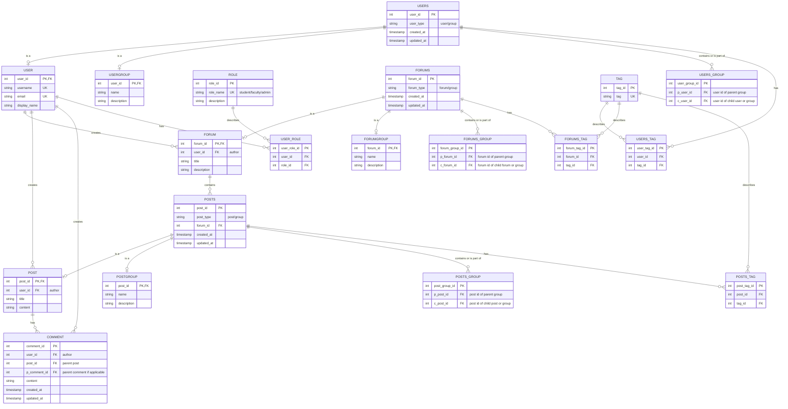

#### AI Contribution Weight: [35%] AI Generated / [65%] Human Written


# Design Specifications
Project Portal Research Blog & Project Discussion Board Service
Version 1.11

#### Notes
I used Copilot to help generate initial ideas and a baseline to start from, but this document is originally largely written by hand. The first draft did not include the constraints section or mock data and only included create operations for JSON schemas, so those portions and the remainder of the JSON schemas were generated using that first draft and then edited. The AI contribution percentage above is a rough estimate representing the contribution of the initial generated baseline plus those added sections, not the actual text percentage in this document.

The log of the conversation is lengthy, so I have included it as a separate AI log file in this repo.

---
## Overview
The Research Blog & Project Discussion Board (RBPDB) Service is a backend service within the Project Portal ecosystem. It is responsible for managing the API that will update and retrieve data from the RBPDB and the database that will store that data.

### Tech Stack
- Python
- FastAPI
- PostgreSQL
- Docker

### Basic Structure Description
**USER**
Users are students, faculty members, or admins for the RBPDB. They have usernames and other identifying information, and they can create or modify Forums and Posts on the board. They are assigned one or more of three roles (Student, Faculty, and Admin) depending on their position within the university and can be organized into Groups as well, which can affect and restrict the Forums and Posts they are able to create and modify.

**USER GROUP**
User Groups are a collection of users representing a project team, class, or similar academic group. Groups containing other groups can also be created.

**FORUM**
Forums are the basis of the board. They are how Posts are categorized, and can represent things like a class, project, or research topic. They have titles and descriptions, as well as optional categorizing tags to mark them as representing a class or project or similar.

**POST**
Posts are discussion threads within a Forum. They are authored by Users and have a title and content as well as optional categorizing tags. These can be used to share things such as announcements, updates, questions on the forum.

**COMMENT**
Comments are used to reply to a post or another comment. They are similar to Posts, with the key difference being that they must have a parent Post or Comment they are replying to. They also may have differences in content, such as not having titles.

**FORUM AND POST GROUPS**
Forums and Posts can also be grouped as needed. For example, all Forums for classes belonging to a specific college within a university or all Posts in a Forum that are updates published by faculty can be grouped as Users see fit. Groups containing other Groups can also be created.

---
## Database Entities and Relationships

Note: The USERS, FORUMS and POSTS tables are structured to facilitate grouping of both individuals and subgroups. USERS is a base entity with a USER subtype for individuals and a USERGROUP subtype for groups. The USER_GROUP table then acts as a junction table that specifies a p_user_id representing the parent user group and c_user_id representing the child user or user group the parent user group contains. The FORUMS and POSTS tables follow this design pattern as well.

---
## API Endpoints
**Base Path:**
/rbpdb-api/v1
### Users

**GET /users**
Return all users.
Optional Query Parameters:
- role_id - Return all users with a specific role
- tag_id - Return all users with a specific tag

**GET /users/{user_id}**
Return single user.

**POST /users**
Create user.

**PUT /users/{user_id}**
Update user.

**DELETE /users/{user_id}**
Delete user.

#### User Groups

**GET /usergroups**
Return all user groups.
Optional Query Parameters:
- user_id - Return all user groups containing a specific user or user group
- tag_id - Return all user groups with a specific tag

**GET /usergroups/{user_id}**
Return single user group.

**POST /usergroups**
Create user group.

**PUT /usergroups/{user_id}**
Update user group.

**DELETE /usergroups/{user_id}**
Delete user group.

**POST /usergroups/{user_id}/users**
Add user or subgroup of users to user group.

**DELETE /usergroups/{user_id}/users/{user_id}**
Remove user or subgroup of users from user group.

### Forums

**GET /forums**
Return all forums.
Optional Query Parameters:
- user_id - Return all forums created by a specific user
- tag_id - Return all forums with a specific tag

**GET /forums/{forum_id}**
Return specific forum.

**POST /forums**
Create forum.

**PUT /forums/{forum_id}**
Update forum.

**DELETE /forums/{forum_id}**
Delete forum.
#### Forum Groups

**GET /forumgroups**
Return all forum groups.
Optional Query Parameters:
- forum_id - Return all forum groups containing a specific forum or forum group
- tag_id - Return all forum groups with a specific tag

**GET /forumgroups/{forum_id}**
Return single forum group.

**POST /forumgroups**
Create forum group.

**PUT /forumgroups/{forum_id}**
Update forum group.

**DELETE /forumgroups/{forum_id}**
Delete forum group.

**POST /forumgroups/{forum_id}/forums**
Add forum or subgroup of forums to forum group.

**DELETE /forumgroups/{forum_id}/forums/{forum_id}**
Remove forum or subgroup of forums from forum group.

### Posts

**GET /posts**
Return all posts.
Optional Query Parameters:
- forum_id - Return all posts within a specific forum
- user_id - Return all posts created by a specific user
- tag_id - Return all posts with a specific tag

**GET /posts/{post_id}**
Return specific post.

**POST /posts**
Create post.

**PUT /posts/{post_id}**
Update post.

**DELETE /posts/{post_id}**
Delete post.
#### Post Groups

**GET /postgroups**
Return all post groups.
Optional Query Parameters:
- post_id - Return all post groups containing a specific post
- tag_id - Return all post groups with a specific tag

**GET /postgroups/{post_id}**
Return specific post group.

**POST /postgroups**
Create post group.

**PUT /postgroups/{post_id}**
Update post group.

**DELETE /postgroups/{post_id}**
Delete post group.

**POST /postgroups/{post_id}/posts**
Add post or subgroup of posts to post group.

**DELETE /postgroups/{post_id}/posts/{post_id}**
Remove post or subgroup of posts from post group.

### Comments

**GET /comments**
Return all comments.
Optional Query Parameters:
- user_id - Return all comments created by specific user
- post_id - Return all comments replying to specific post
- p_comment_id - Return all comments replying to specific parent comment

**GET /comments/{comment_id}**
Return specific comment.

**POST /comments**
Create comment.

**PUT /comments/{comment_id}**
Update comment.

**DELETE /comments/{comment_id}**
Delete comment.

---
## Field Details and Constraints

### User

| Field        | Required | Constraints                        |
| ------------ | -------- | ---------------------------------- |
| username     | Yes      | 3-50 chars, unique                 |
| email        | Yes      | Valid email, max 254 chars, unique |
| display_name | Yes      | 1-100 chars                        |
| roles        | Yes      | Minimum 1 value                    |

### User Group

|Field|Required|Constraints|
|---|---|---|
|name|Yes|1-100 chars|
|description|No|Max 1000 chars|
|users|No|Array of valid user IDs|
|tags|No|Max 25 tags|

### Forum

|Field|Required|Constraints|
|---|---|---|
|user_id|Yes|Existing user|
|title|Yes|1-200 chars|
|description|No|Max 5000 chars|
|tags|No|Max 25 tags|

### Forum Group

|Field|Required|Constraints|
|---|---|---|
|name|Yes|1-200 chars|
|description|No|Max 5000 chars|
|forums|No|Array of forum IDs|
|tags|No|Max 25 tags|

### Post

|Field|Required|Constraints|
|---|---|---|
|user_id|Yes|Existing user|
|forum_id|Yes|Existing forum|
|title|Yes|1-200 chars|
|content|Yes|1-10000 chars|
|tags|No|Max 25 tags|

### Post Group

|Field|Required|Constraints|
|---|---|---|
|forum_id|Yes|Existing forum|
|name|Yes|1-200 chars|
|description|No|Max 5000 chars|
|posts|No|Array of post IDs|
|tags|No|Max 25 tags|

### Comment

|Field|Required|Constraints|
|---|---|---|
|user_id|Yes|Existing user|
|post_id|Yes|Existing post|
|p_comment_id|No|Existing comment|
|content|Yes|1-5000 chars|

---
## JSON Schemas

### Users

#### GET /users/{user_id}
**Response**
```json
{
  "user_id": 123,
  "user_type": "user",
  "username": "jdoe",
  "email": "jdoe@university.edu",
  "display_name": "John Doe",
  "roles": [
    "student"
  ],
  "tags": [
    "Undergraduate",
    "METCS"
  ],
  "created_at": "2026-11-02T11:06:07.235541Z",
  "updated_at": "2026-11-05T15:22:11.947651Z"
}
```

#### POST /users
**Request**
```json
{
  "username": "jdoe",
  "email": "jdoe@university.edu",
  "display_name": "John Doe",
  "roles": [
    "student"
  ],
  "tags": [
    "Undergraduate",
    "METCS"
  ]
 }
```

**Response**
```json
{
  "user_id": 123,
  "user_type": "user",
  "username": "jdoe",
  "email": "jdoe@university.edu",
  "display_name": "John Doe",
  "roles": [
    "student"
  ],
  "tags": [
    "Undergraduate",
    "METCS"
  ],
  "created_at": "2026-11-02T11:06:07.235541Z",
  "updated_at": "2026-11-05T15:22:11.947651Z"
}
```

#### PUT /users/{user_id}
**Request**
```json
{
  "email": "newemail@university.edu",
  "display_name": "John A. Doe",
  "roles": [
    "student",
    "admin"
  ]
 }
```

**Response**
```json
{
  "user_id": 123,
  "user_type": "user",
  "username": "jdoe",
  "email": "newemail@university.edu",
  "display_name": "John A. Doe",
  "roles": [
    "student",
    "admin"
  ],
  "tags": [
    "Undergraduate",
    "METCS"
  ],
  "created_at": "2026-11-02T11:06:07.235541Z",
  "updated_at": "2026-11-17T15:22:11.947651Z"
}
```

### User Groups

#### GET /usergroups/{user_id}
**Response**
```json
{
  "user_id": 12345,
  "user_type": "group",
  "name": "CS763 Students (Fall 26)",
  "description": "Fall 26 Students enrolled in CS763: Secure Software Development",
  "users": [
    123,
    234,
    345,
    456
  ],
  "tags": [
    "Student Group",
    "Fall 2026"
  ],
  "created_at": "2026-11-02T11:06:07.235541Z",
  "updated_at": "2026-11-05T15:22:11.947651Z"
}
```

#### POST /usergroups
**Request**
```json
{
  "name": "CS763 Students (Fall 26)",
  "description": "Fall 26 Students enrolled in CS763: Secure Software Development",
  "users": [
    123,
    234,
    345,
    456
  ],
  "tags": [
    "Student Group",
    "Fall 2026"
  ]
}
```
  
**Response**
```json
{
  "user_id": 12345,
  "user_type": "group",
  "name": "CS763 Students (Fall 26)",
  "description": "Fall 26 Students enrolled in CS763: Secure Software Development",
  "users": [
    123,
    234,
    345,
    456
  ],
  "tags": [
    "Student Group",
    "Fall 2026"
  ],
  "created_at": "2026-11-02T11:06:07.235541Z",
  "updated_at": "2026-11-05T15:22:11.947651Z"
}
```
  
#### PUT /usergroups/{user_id}
**Request**
```json
{
  "name": "CS763 Students (Fall 2026)",
  "description": "Updated description",
  "users": [
    123,
    234,
    345
  ],
  "tags": [
    "Student Group",
    "Graduate"
  ]
}
```
  

**Response**
```json
{
  "user_id": 12345,
  "user_type": "group",
  "name": "CS763 Students (Fall 2026)",
  "description": "Updated description",
  "users": [
    123,
    234,
    345
  ],
  "tags": [
    "Student Group",
    "Graduate"
  ],
  "created_at": "2026-11-02T11:06:07.235541Z",
  "updated_at": "2026-11-17T15:22:11.947651Z"
}
```
### Forums

#### GET /forums/{forum_id}
**Response**
```json
{
  "forum_id": 874368,
  "forum_type": "forum",
  "user_id": 987,
  "title": "CS763 O2 Secure Software Development (Fall 26)",
  "description": "Forum for all topics pertaining to CS763, Fall 2026",
  "tags": [
    "Class Forum",
    "METCS",
    "Fall 2026"
  ],
  "created_at": "2026-11-02T11:06:07.235541Z",
  "updated_at": "2026-11-05T15:22:11.947651Z"
}
```

#### POST /forums
**Request**
```json
{
  "user_id": 987,
  "title": "CS763 O2 Secure Software Development (Fall 26)",
  "description": "Forum for all topics pertaining to CS763, Fall 2026",
  "tags": [
    "Class Forum",
    "METCS",
    "Fall 2026"
  ]
}
```
  
**Response**
```json
{
  "forum_id": 874368,
  "forum_type": "forum",
  "user_id": 987,
  "title": "CS763 O2 Secure Software Development (Fall 26)",
  "description": "Forum for all topics pertaining to CS763, Fall 2026",
  "tags": [
    "Class Forum",
    "METCS",
    "Fall 2026"
  ],
  "created_at": "2026-11-02T11:06:07.235541Z",
  "updated_at": "2026-11-05T15:22:11.947651Z"
}
```

#### PUT /forums/{forum_id}

**Request**
```json
{
  "title": "CS763 O2 Secure Software Development",
  "description": "Updated forum description",
  "tags": [
    "Class Forum",
    "Graduate Course"
  ]
}
```

**Response**
```json
{
  "forum_id": 874368,
  "forum_type": "forum",
  "user_id": 987,
  "title": "CS763 O2 Secure Software Development",
  "description": "Updated forum description",
  "tags": [
    "Class Forum",
    "Graduate Course"
  ],
  "created_at": "2026-11-02T11:06:07.235541Z",
  "updated_at": "2026-11-17T15:22:11.947651Z"
}
```

### Forum Groups

#### GET /forumgroups/{forum_id}
**Response**
```json
{
  "forum_id": 56789,
  "forum_type": "group",
  "name": "METCS Class Forums (Fall 26)",
  "description": "Forums for all METCS classes offered in Fall 2026 Semester",
  "forums": [
    123,
    234,
    345,
    456
  ],
  "tags": [
    "Class Forum",
    "METCS",
    "Fall 2026"
  ],
  "created_at": "2026-11-02T11:06:07.235541Z",
  "updated_at": "2026-11-05T15:22:11.947651Z"
}
```

#### POST /forumgroups
**Request**
```json
{
  "name": "METCS Class Forums (Fall 26)",
  "description": "Forums for all METCS classes offered in Fall 2026 Semester",
  "forums": [
    123,
    234,
    345,
    456
  ],
  "tags": [
    "Class Forum",
    "METCS",
    "Fall 2026"
  ]
}
```

**Response**
```json
{
  "forum_id": 56789,
  "forum_type": "group",
  "name": "METCS Class Forums (Fall 26)",
  "description": "Forums for all METCS classes offered in Fall 2026 Semester",
  "forums": [
    123,
    234,
    345,
    456
  ],
  "tags": [
    "Class Forum",
    "METCS",
    "Fall 2026"
  ],
  "created_at": "2026-11-02T11:06:07.235541Z",
  "updated_at": "2026-11-05T15:22:11.947651Z"
}
```

#### PUT /forumgroups/{forum_id}
**Request**
```json
{
  "name": "METCS Graduate Forums",
  "description": "Updated description",
  "forums": [
    123,
    234,
    345
  ],
  "tags": [
    "Graduate",
    "METCS"
  ]
}
```

**Response**
```json
{
  "forum_id": 56789,
  "forum_type": "group",
  "name": "METCS Graduate Forums",
  "description": "Updated description",
  "forums": [
    123,
    234,
    345
  ],
  "tags": [
    "Graduate",
    "METCS"
  ],
  "created_at": "2026-11-02T11:06:07.235541Z",
  "updated_at": "2026-11-17T15:22:11.947651Z"
}
```

### Posts

#### GET /posts/{post_id}
**Response**
```json
{
  "post_id": 64368473,
  "post_type": "post",
  "user_id": 987,
  "forum_id": 874368,
  "title": "Lab 1 Q&A",
  "content": "Please comment with any questions on Lab 1.",
  "tags": [
    "Lab",
    "Q&A",
    "Instructor Post"
  ],
  "created_at": "2026-11-02T11:06:07.235541Z",
  "updated_at": "2026-11-05T15:22:11.947651Z"
}
```

#### POST /posts
**Request**
```json
{
  "user_id": 987,
  "forum_id": 874368,
  "title": "Lab 1 Q&A",
  "content": "Please comment with any questions on Lab 1.",
  "tags": [
    "Lab",
    "Q&A",
    "Instructor Post"
  ]
}
```

**Response**
```json
{
  "post_id": 64368473,
  "post_type": "post",
  "user_id": 987,
  "forum_id": 874368,
  "title": "Lab 1 Q&A",
  "content": "Please comment with any questions on Lab 1.",
  "tags": [
    "Lab",
    "Q&A",
    "Instructor Post"
  ],
  "created_at": "2026-11-02T11:06:07.235541Z",
  "updated_at": "2026-11-05T15:22:11.947651Z"
}
```

#### PUT /posts/{post_id}
**Request**
```json
{
  "title": "Lab 1 Questions and Answers",
  "content": "Please post any questions related to Lab 1 here.",
  "tags": [
    "Lab",
    "Q&A"
  ]
}
```

**Response**
```json
{
  "post_id": 64368473,
  "post_type": "post",
  "user_id": 987,
  "forum_id": 874368,
  "title": "Lab 1 Questions and Answers",
  "content": "Please post any questions related to Lab 1 here.",
  "tags": [
    "Lab",
    "Q&A"
  ],
  "created_at": "2026-11-02T11:06:07.235541Z",
  "updated_at": "2026-11-17T15:22:11.947651Z"
}
```

### Post Groups

#### GET /postgroups/{post_id}
**Response**
```json
{
  "post_id": 56735,
  "post_type": "group",
  "forum_id": 874368,
  "name": "Lab Q&A Threads",
  "description": "All CS763 Lab Q&A Threads for Final Exam reference.",
  "posts": [
    64368473,
    78932643,
    87364832,
    89723648
  ],
  "tags": [
    "Final Review"
  ],
  "created_at": "2026-11-02T11:06:07.235541Z",
  "updated_at": "2026-11-05T15:22:11.947651Z"
}
```  
#### POST /postgroups
**Request**
```json
{
  "forum_id": 874368,
  "name": "Lab Q&A Threads",
  "description": "All CS763 Lab Q&A Threads for Final Exam reference.",
  "posts": [
    64368473,
    78932643,
    87364832,
    89723648
  ],
  "tags": [
    "Final Review"
  ]
}
```

**Response**
```json
{
  "post_id": 56735,
  "post_type": "group",
  "forum_id": 874368,
  "name": "Lab Q&A Threads",
  "description": "All CS763 Lab Q&A Threads for Final Exam reference.",
  "posts": [
    64368473,
    78932643,
    87364832,
    89723648
  ],
  "tags": [
    "Final Review"
  ],
  "created_at": "2026-11-02T11:06:07.235541Z",
  "updated_at": "2026-11-05T15:22:11.947651Z"
}
```

#### PUT /postgroups/{post_id}
**Request**
```json
{
  "name": "Lab and Exam Review Threads",
  "description": "Updated collection of review discussions.",
  "posts": [
    64368473,
    78932643
  ],
  "tags": [
    "Review",
    "Exam Prep"
  ]
}
```

**Response**
```json
{
  "post_id": 56735,
  "post_type": "group",
  "forum_id": 874368,
  "name": "Lab and Exam Review Threads",
  "description": "Updated collection of review discussions.",
  "posts": [
    64368473,
    78932643
  ],
  "tags": [
    "Review",
    "Exam Prep"
  ],
  "created_at": "2026-11-02T11:06:07.235541Z",
  "updated_at": "2026-11-17T15:22:11.947651Z"
}
```

### Comments

#### GET /comments/{comment_id}
**Response**
```json
{
  "comment_id": 50413740,
  "user_id": 413,
  "post_id": 78932643,
  "p_comment_id": 56532,
  "content": "thanks, that's really helpful :)",
  "created_at": "2026-11-02T11:06:07.235541Z",
  "updated_at": "2026-11-05T15:22:11.947651Z"
}
```

#### POST /comments
**Request**
```json
{
  "user_id": 413,
  "post_id": 78932643,
  "p_comment_id": 56532,
  "content": "thanks, that's really helpful :)"
}
```

**Response**
```json
{
  "comment_id": 50413740,
  "user_id": 413,
  "post_id": 78932643,
  "p_comment_id": 56532,
  "content": "thanks, that's really helpful :)",
  "created_at": "2026-11-02T11:06:07.235541Z",
  "updated_at": "2026-11-05T15:22:11.947651Z"
}
```

#### PUT /comments/{comment_id}
**Request**
```json
{
  "content": "Thank you, that's really helpful."
}
```

**Response**

```json
{
  "comment_id": 50413740,
  "user_id": 413,
  "post_id": 78932643,
  "p_comment_id": 56532,
  "content": "Thank you, that's really helpful.",
  "created_at": "2026-11-02T11:06:07.235541Z",
  "updated_at": "2026-11-17T15:22:11.947651Z"
}
```

### List Response Schema
To be used consistently for all collection endpoints.
#### List Wrapper
```json
{
  "count": 0,
  "results": [

  ]
}
```

#### GET /users (Example)
```json
{
  "count": 2,
  "results": [
	{
	  "user_id": 123,
	  "user_type": "user",
	  "username": "jdoe",
	  "email": "jdoe@university.edu",
	  "display_name": "John Doe",
	  "roles": [
	    "student"
	  ],
	  "tags": [
	    "Undergraduate",
	    "METCS"
	  ],
	  "created_at": "2026-11-02T11:06:07.235541Z",
	  "updated_at": "2026-11-05T15:22:11.947651Z"
	},
	{
	  "user_id": 234,
	  "user_type": "user",
	  "username": "scarp",
	  "email": "scarp@university.edu",
	  "display_name": "Sabrina Carp",
	  "roles": [
	    "student"
	  ],
	  "tags": [
	    "Undergraduate",
	    "METCS"
	  ],
	  "created_at": "2026-12-02T11:06:07.235541Z",
	  "updated_at": "2026-12-05T15:22:11.947651Z"
	},
  ]
}
```

### Status Codes
#### GET

|Status|Meaning|
|---|---|
|200|Success|
|400|Invalid query parameter|
|401|Unauthorized|
|403|Forbidden|
|404|Resource not found|
|500|Internal server error|

#### POST

|Status|Meaning|
|---|---|
|201|Created|
|400|Validation error|
|401|Unauthorized|
|403|Forbidden|
|409|Duplicate resource|
|500|Internal server error|

#### PUT

|Status|Meaning|
|---|---|
|200|Updated|
|400|Validation error|
|401|Unauthorized|
|403|Forbidden|
|404|Resource not found|
|409|Conflict|
|500|Internal server error|

#### DELETE

| Status | Meaning               |
| ------ | --------------------- |
| 204    | Deleted               |
| 401    | Unauthorized          |
| 403    | Forbidden             |
| 404    | Resource not found    |
| 500    | Internal server error |
### Standard Error Response

#### Error Response Schema
```json
{
  "error": {
    "code": "VALIDATION_ERROR",
    "message": "One or more fields failed validation.",
    "details": [
      {
        "field": "email",
        "message": "Email address is invalid."
      }
    ]
  },
  "timestamp": "2026-11-02T11:06:07.235541Z",
  "request_id": "0f45ef7d-790a-4b82-b9fc-fd2c8afc8d5b"
}
```

#### Error Codes

VALIDATION_ERROR
UNAUTHORIZED
FORBIDDEN
RESOURCE_NOT_FOUND
RESOURCE_CONFLICT
DUPLICATE_RESOURCE
INTERNAL_SERVER_ERROR

## Static Mock Data

Currently, my design for this service does not require any external resources. Any information hosted externally such as class details or project documentation could be shared as hyperlinks to their source within the descriptions or content of forums, posts and comments. If future design iterations depend on external data, mock data will be added here for testing purposes.